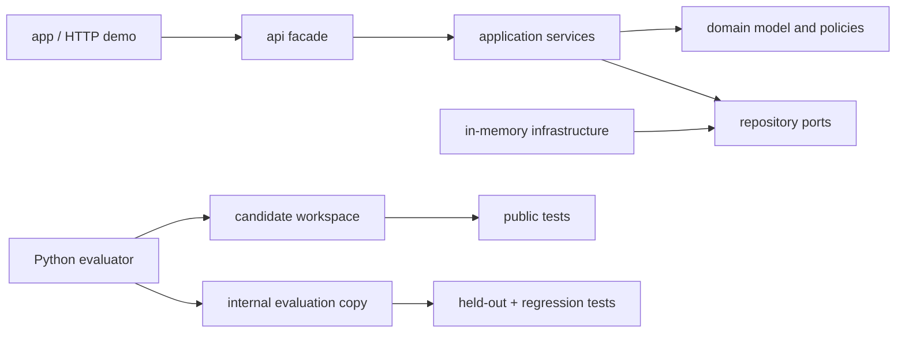

# Java Refactoring RL Environment

[](https://github.com/Kartikm09/java-refactoring-rl-environment/actions/workflows/ci.yml)
[](LICENSE)

A modular Java 25 order-and-inventory service plus four reproducible engineering
environments for evaluating AI coding-agent patches. It demonstrates enterprise
maintenance, transaction and concurrency reasoning, mocked payment-status events,
explicit failure classification, safe refactoring, benchmark-backed
optimization, and evidence-first review.

**Toolchain:** Temurin 25.0.3, Gradle 9.6.1, Kotlin DSL, JUnit Jupiter, AssertJ,
SpotBugs, Checkstyle, JaCoCo, and JMH.

> Independent public proof of work. Every service record, fixture, task, patch, and
> report is synthetic; no employer or private benchmark commissioned this project.

## Architecture



## Task catalogue

| Task | Engineering work | Primary evidence |
| --- | --- | --- |
| `task-001` | Fix transactional reservation idempotency under retries | concurrency and duplicate-request tests |
| `task-002` | Implement partial cancellation | contract, validation, audit, and restoration tests |
| `task-003` | Refactor pricing rules into composition | golden-master and architecture checks |
| `task-004` | Optimize allocation report aggregation | deterministic work metric plus JMH evidence |

## One-command quick start

```bash
make setup && make verify-all
```

The demo starts with `docker compose up --build` or `./gradlew :app:run`. Health is
available at `http://localhost:8081/health`.

## Evaluate a patch

```bash
make evaluate TASK=task-001 PATCH=tasks/task-001/golden/solution.patch
```

The evaluator creates a candidate-visible baseline with public tests, validates patch
paths, and runs formatting, static analysis, build, and public tests. Only then does it
copy the candidate into an internal workspace and overlay held-out tests. Golden patches,
golden explanations, held-out tests, and score internals never enter the candidate-visible
workspace.

**Accepted example:** the golden `task-001` patch produces `classification=accepted`,
passes duplicate and concurrent retry tests, and preserves distinct-key behavior.

**Rejected example:** `incorrect_patches/prohibited-file.patch` is rejected before code
execution with `classification=prohibited_file_change`.

Generated artifacts: `result.json`, `evaluation_report.md`, `test_summary.json`,
`changed_files.json`, `timing.json`, and `score_breakdown.json`.

## Quality commands

```bash
./gradlew clean check
./gradlew test
./gradlew integrationTest
./gradlew jacocoTestReport
./gradlew spotbugsMain spotbugsTest
./gradlew jmh
make benchmark
make evaluator-test
```

CI repeats formatting, unit/integration tests, static analysis, evaluator isolation,
and representative accepted/rejected patch checks. Review the genuine local
[benchmark evidence](reports/benchmark-evidence.md),
[Docker verification](reports/docker-verification.md), and `ARCHITECTURE.md` for
module boundaries.

## Skills demonstrated

Java 25, Gradle Kotlin DSL, modular architecture, domain modelling, idempotency,
concurrency safety, transaction compensation, API contracts, JUnit, AssertJ, SpotBugs,
Checkstyle, JaCoCo, JMH, Python evaluation tooling, CI/CD, Docker, code review, and
benchmark interpretation.

## Recruiter walkthrough

1. Scan the architecture and task table above.
2. Open `application/src/main` and its concurrency-focused tests.
3. Compare a task baseline with `golden/solution.patch` and an incorrect patch.
4. Inspect the six evaluator artifacts under `reports/evaluations/`.
5. Review `DECISIONS.md`, CI, and the release process for engineering judgment.

## Security and sandbox limitations

Patch path checks, output caps, timeouts, and candidate/held-out separation are safety
controls, not a hardened untrusted-code sandbox. Run unknown patches only inside an
externally isolated, credential-free VM or container. The HTTP demo is intentionally
local and has no authentication, payment network, or production persistence.

## Honest limitations

The service is synthetic and intentionally smaller than a production commerce platform.
The default repository implementation is in memory; PostgreSQL is documented as an
optional extension rather than presented as completed. Deterministic work metrics make
task scoring stable, while JMH measurements remain machine-dependent and are evidence,
not universal performance guarantees.
